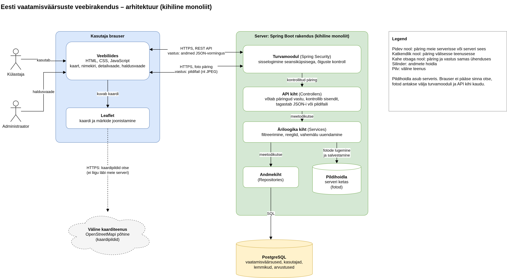
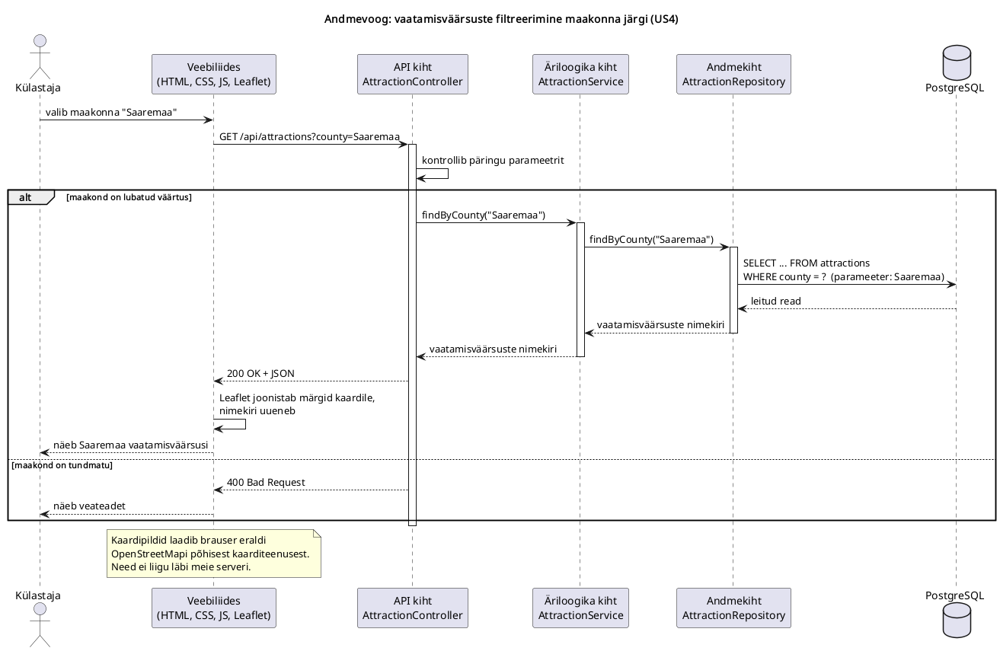

# 4. Tarkvaraarhitektuur

See dokument kirjeldab Eesti vaatamisväärsuste avastamise veebirakenduse kavandatud arhitektuuri. Tegemist on arendusplaaniga: rakendust, API-t ega andmebaasi ei ole ehitatud ega testitud.

## 4.1 Rakenduse tüüp ja arhitektuuri eesmärk

**Rakenduse tüüp:** veebirakendus, mis töötab nii arvuti kui ka telefoni brauseris. Eraldi mobiilirakendus on esimeses versioonis välja jäetud (US11, prioriteet Won't, vt `docs/02-methodology-backlog.md`).

**Arhitektuur:** kihiline monoliit. Serveris on üks rakendus, mis on jagatud kihtideks. Veebiliides töötab brauseris ja suhtleb serveriga REST API kaudu.

**Arhitektuuri eesmärgid:**
- lihtne arendada ja paigaldada väikesel meeskonnal;
- kood on kihtideks jagatud, et iga osa muutmine mõjutaks võimalikult vähe teisi osi;
- API on veebiliidesest eraldi, et hiljem saaks sama serverit kasutada ka mobiilirakendus;
- rakendust saab vajaduse korral suurema kasutajate arvu jaoks laiendada.

## 4.2 Tehnoloogiad

| Osa | Tehnoloogia | Põhjendus |
|---|---|---|
| Veebiliides | HTML, CSS, JavaScript | Tuttavad põhitehnoloogiad. Esimeses versioonis ei kasuta raamistikku, et vältida lisaõppimist. |
| Kaart | Leaflet | Avatud lähtekoodiga JavaScripti teek interaktiivsete kaartide jaoks. [2] |
| Kaardipildid | OpenStreetMapi põhine kaarditeenus | Avatud kaardiandmed. Kasutustingimused on kirjeldatud punktis 4.9. [1] |
| Server | Java, Spring Boot | Java on tuttav keel. Spring Boot on levinud Java raamistik veebirakenduste ja REST API-de tegemiseks. |
| Andmebaas | PostgreSQL | Levinud tasuta relatsiooniline andmebaas. |
| Andmevahetus | REST API, JSON | Lihtne ja levinud viis, kuidas brauser ja mobiilirakendus serveriga suhtlevad. |

## 4.3 Arhitektuuriskeem

Muudetav lähtefail: `diagrams/architecture.drawio` (avatakse rakendusega diagrams.net).

Skeemil on näha:
- kasutajad (külastaja ja administraator) kasutavad brauseris veebiliidest;
- brauser laadib **kaardipildid otse välisest kaarditeenusest** (katkendlik nool);
- brauser saadab **andmepäringud** meie serverisse ja saab vastuseks **andmed JSON-vormingus**;
- brauser küsib **vaatamisväärsuste fotosid** samuti meie serverilt ja saab vastuseks **pildifaili**;
- kõik päringud meie serverisse läbivad turvamooduli;
- pildihoidla asub serveris ja brauser ei pääse sellele otse ligi.

## 4.4 Komponendid ja nende ülesanded

| Komponent | Kus asub | Ülesanne |
|---|---|---|
| **Veebiliides** | Kasutaja brauseris | Näitab kaarti, nimekirja, detailvaadet ja administraatori haldusvaadet. Saadab päringuid API-le ja näitab vastuseid. |
| **Leaflet** | Kasutaja brauseris | Joonistab kaardi ja vaatamisväärsuste märgid. |
| **Turvamoodul** (Spring Security) | Serveris | Kontrollib sisselogimist ja õigusi, näiteks et haldusvaatesse pääseb ainult administraator. Esimeses versioonis kasutatakse veebis sisselogimiseks seansiküpsist. |
| **API kiht** (nt `AttractionController`) | Serveris | Võtab vastu HTTP-päringud ja kontrollib sisendit. Andmepäringutele tagastab vastuse JSON-vormingus, fotopäringutele pildifaili. |
| **Äriloogika kiht** (nt `AttractionService`) | Serveris | Rakenduse reeglid: filtreerimine, õiguste kontroll, keskmise hinde arvutamine. |
| **Andmekiht** (nt `AttractionRepository`) | Serveris | Loeb andmeid andmebaasist ja kirjutab neid sinna. |
| **Pildihoidla** | Esialgu serveri kettal | Hoiab vaatamisväärsuste fotosid. Brauser ei pääse pildihoidlale otse ligi. Fotod antakse brauserile serveri kaudu. |
| **Andmebaas** (PostgreSQL) | Andmebaasiserveris | Hoiab vaatamisväärsusi, kasutajaid, lemmikuid ja arvustusi. |
| **Kaarditeenus** | Väline teenus | Annab kaardi taustapildid (kaardipildid). |

**Kihtide reegel:** iga kiht suhtleb ainult endast vahetult allpool oleva kihiga. API kiht ei pöördu otse andmebaasi poole, vaid kasutab äriloogika kihti. Nii saab näiteks andmebaasi vahetada ilma API-t muutmata.

## 4.5 Andmevoog: filtreerimine maakonna järgi

Näide põhineb kasutajalool US4 („Külastajana tahan filtreerida vaatamisväärsusi maakonna ja tüübi järgi…”). Tüübi järgi filtreerimine toimub samamoodi.

Muudetav lähtefail: `diagrams/filter-flow.puml` (PlantUML järjestusskeem).

1. Külastaja valib veebiliideses maakonna, näiteks „Saaremaa”.
2. Veebiliides saadab serverile päringu `GET /api/attractions?county=Saaremaa`.
3. **API kiht** võtab päringu vastu ja kontrollib, kas maakond on lubatud väärtus.
4. **Äriloogika kiht** küsib andmekihilt selle maakonna vaatamisväärsusi.
5. **Andmekiht** teeb andmebaasi päringu, näiteks `SELECT ... FROM attractions WHERE county = ?`. Maakonna nimi antakse päringule eraldi parameetrina, mitte ei kleebita SQL-teksti sisse. See kaitseb SQL-süstimise eest.
6. **PostgreSQL** tagastab leitud read.
7. Andmed liiguvad kihtide kaudu tagasi ja API kiht teisendab need JSON-vormingusse.
8. Server saadab vastuse `200 OK` koos JSON-iga.
9. Veebiliides uuendab nimekirja ja Leaflet joonistab kaardile ainult Saaremaa vaatamisväärsused.

Kui maakond on tundmatu, vastab server `400 Bad Request` ja veebiliides näitab veateadet. Kui maakonnas vaatamisväärsusi pole, saadab server tühja nimekirja.

Kaardipildid ei liigu läbi meie serveri: brauser laadib need otse välisest kaarditeenusest. Vaatamisväärsuste fotod küsib brauser aga meie serverilt, mis loeb need pildihoidlast ja tagastab pildifailina.

Lihtsustatud näide JSON-vastusest. **Näide on illustratiivne: nimi ja koordinaadid on välja mõeldud ega ole päris andmed.**

    [
      {
        "id": 1,
        "name": "Näidislinnus",
        "county": "Saaremaa",
        "type": "loss",
        "latitude": 58.3,
        "longitude": 22.5
      }
    ]

## 4.6 Arhitektuurivariantide võrdlus

| Tunnus | **Kihiline monoliit** (valitud) | **Mikroteenused** | **Serveris genereeritud lehed** |
|---|---|---|---|
| Ülesehitus | Üks serverirakendus, jagatud kihtideks. Veebiliides suhtleb serveriga API kaudu. | Mitu eraldi teenust, näiteks vaatamisväärsused, kasutajad, arvustused. Igal võib olla oma andmebaas. | Server koostab valmis HTML-lehed (nt Spring Boot ja Thymeleaf). Eraldi API-t ei ole. |
| Arendamine | Lihtne, üks koodibaas | Keeruline: teenuste omavaheline suhtlus, mitu koodibaasi | Kõige lihtsam |
| Paigaldamine | Üks rakendus | Mitu rakendust, vaja jälgimist ja automaatikat | Üks rakendus |
| Skaleerimine | Kogu rakendus korraga | Iga teenus eraldi | Kogu rakendus korraga |
| Vigade mõju | Üks viga võib mõjutada kogu rakendust | Viga mõjutab sageli ainult üht teenust | Üks viga võib mõjutada kogu rakendust |
| Mobiilirakenduse lisamine | API on juba olemas | API on juba olemas | API tuleb juurde teha |
| Interaktiivne kaart | Sobib hästi, andmeid saab uuendada ilma lehte uuesti laadimata | Sobib hästi | Keerulisem, sest iga filtri muutmine laadib sageli uue lehe |
| Sobib | Väikesele ja keskmisele meeskonnale | Suurele organisatsioonile, kus on mitu meeskonda | Lihtsale, vähe interaktiivsele veebilehele |

## 4.7 Valitud lahenduse põhjendus

1. **Projekt ja meeskond on väikesed.** Ühte rakendust on lihtsam arendada, testida ja paigaldada kui mitut teenust.
2. **Kihid hoiavad koodi korras.** Iga kihi ülesanne on selge ja muudatused jäävad enamasti ühe kihi piiresse.
3. **Eraldi API võimaldab hiljem lisada mobiilirakenduse** (vt punkt 4.10). Serveris genereeritud lehtedega see nii lihtne ei oleks.
4. **Interaktiivne kaart** vajab andmete uuendamist ilma lehte uuesti laadimata. See sobib hästi API ja JavaScripti kooslusega.
5. **Tehnoloogiad on meeskonnale tuttavad** (JavaScript ja Java), seega kulub vähem aega õppimisele.
6. **Mikroteenused oleksid praegu liiga keerulised.** Nende eelised tulevad esile suures süsteemis ja suures organisatsioonis, mida meil ei ole.

**Puudused, millega arvestame:**
- rakendus skaleerub ainult tervikuna;
- kui kihtide reeglist kinni ei peeta, muutub kood aja jooksul segaseks;
- raamistikuta JavaScript võib liidese kasvades muutuda raskesti hallatavaks.

## 4.8 Kui kasutajaid on 100 korda rohkem

### Võimalikud kitsaskohad

| Komponent | Miks võib see muutuda kitsaskohaks |
|---|---|
| Kaardipildid | OpenStreetMap Foundationi avalik kaardipiltide server ei ole mõeldud suureks kasutuseks ja selle töökindlust ei garanteerita. [1] |
| Server | Üks server ei jõua kõiki päringuid teenindada. |
| Andmebaas | Kõik päringud jõuavad lõpuks ühte andmebaasi. |
| Pildid serveri kettal | Pildid koormavad serverit ega sobi mitme serveri vahel jagamiseks. |

### Kavandatud muudatused

1. **Mitu serverit koormusjaoturi taga.** Käivitame sama rakenduse mitu koopiat ja koormusjaotur (load balancer) jagab päringud nende vahel. See eeldab, et server ei hoia kasutaja seisundit ainult oma mälus.
2. **Vahemälu.** Vaatamisväärsuste andmed muutuvad harva, seega saab sagedasi vastuseid ajutiselt meelde jätta ja andmebaasi vähem koormata. Kui administraator salvestab muudatuse, uuendatakse või tühjendatakse selle vaatamisväärsuse andmed vahemälus kohe. Nii jääb kehtima US5 nõue, et muudatus on kasutajatele kohe nähtav (vt `docs/02-methodology-backlog.md`).
3. **Andmebaasi lugemiskoopiad.** Enamik päringuid ainult loeb andmeid. Lugemiskoopiad võtavad osa koormusest põhiandmebaasilt üle.
4. **Pildid failihoidlasse ja CDN-i.** Pildid tõstetakse eraldi failihoidlasse ja kasutajale serveeritakse need sisuedastusvõrgu (CDN) kaudu.
5. **Teine kaarditeenus.** Kasutame tasulist OpenStreetMapi põhist kaarditeenust või oma kaardipiltide serverit.

Monoliiti ei pea selleks mikroteenusteks jagama. Mõne osa eraldamist eraldi teenuseks kaaluksime alles siis, kui just see osa vajab teistest erinevat skaleerimist.

## 4.9 Kaarditeenuse kasutustingimused

OpenStreetMap Foundationi kaardipiltide kasutustingimuste järgi [1]:
- kaardil peab olema selgelt nähtav OpenStreetMapi litsentsi viide;
- teenuse töökindlust ei garanteerita;
- liiga suur või sobimatu kasutus võidakse ilma hoiatuseta blokeerida;
- kui tingimusi ei saa täita, tuleb kasutada mõnda teist OpenStreetMapi põhist teenust.

Esimeses versioonis piisab avalikust teenusest. Enne avalikku väljalaset tuleb otsustada, kas kasutame mõnda teist kaarditeenuse pakkujat.

## 4.10 Eraldi mobiilirakenduse lisamine

**Mida saab taaskasutada:**
- REST API;
- äriloogika ja andmekiht;
- andmebaas ja pildid.

**Mida tuleb muuta või lisada:**
- **Mobiilirakendus ise.** Tuleb valida, kas teha eraldi Androidi ja iOS-i rakendused või üks JavaScriptil põhinev rakendus mõlemale platvormile.
- **Sisselogimine.** Veebis kasutatakse seansiküpsist. Mobiilirakendusele sobib paremini tokenipõhine sisselogimine, mis tuleb lisada.
- **API versioonimine**, näiteks `/api/v1/...`. Vanad mobiilirakenduse versioonid jäävad telefonidesse kauaks, seega ei tohi API muutmine neid katki teha.
- **API kohandamine:** väiksemad vastused aeglase ühenduse jaoks. Vajaduse korral ka tõuketeavitused ja võrguühenduseta kasutamine.

API taaskasutamine eeldab, et see sobib mobiilikliendile, ja võib nõuda lisatööd (vt ka `docs/01-development-process.md`, punkt 1.4).

## 4.11 Riskid

| Risk | Mõju | Kuidas vähendada |
|---|---|---|
| Sõltuvus välisest kaarditeenusest | Kaart ei pruugi töötada | Valmis olla teenusepakkujat vahetama (punkt 4.9) |
| Kihtide segunemine | Koodi on raske muuta | Kihtide reegel ja koodiülevaatus |
| Raamistikuta liides muutub keeruliseks | Arendus aeglustub | Liidese kasvades kaaluda raamistikku |
| Turvavead (paroolid, administraatori õigused, sisendi kontroll) | Andmed võivad lekkida või neid võidakse muuta | Spring Security, paroolide räsimine, sisendi kontroll, parameetritega SQL-päringud |
| Vahemälu näitab vanu andmeid | Kasutaja näeb aegunud infot ja US5 nõue ei ole täidetud | Administraatori muudatuse salvestamisel uuendatakse või tühjendatakse vastav vahemälu |
| Isikuandmed (kasutajakontod, arvustused) | Isikuandmete kaitse nõuded tuleb täita | Koguda ainult vajalikke andmeid ja nõuded enne avalikku väljalaset üle kontrollida |

## 4.12 Mida tuleb juurde õppida

1. **REST API:** päring ja vastus, HTTP-meetodid (GET, POST, PUT, DELETE), olekukoodid (200, 400, 404) ja JSON.
2. **Kihiline arhitektuur:** controller → service → repository.
3. **Spring Boot ja Spring Security** põhimõtte tasemel.
4. **SQL ja PostgreSQL:** tabelid, seosed ja parameetritega päringud.
5. **Leaflet:** kuidas kaart ja märgid brauseris tekivad.
6. **Skaleerimise mõisted:** koormusjaotur, vahemälu, CDN ja lugemiskoopia.
7. **Sisselogimine:** seansi ja tokeni erinevus.

## 4.13 Kokkuvõte kaitsmiseks

- Valisin **kihilise monoliidi**, sest projekt ja meeskond on väikesed ning üht rakendust on lihtne arendada ja paigaldada.
- **Veebiliides** (HTML, CSS, JavaScript ja Leaflet) suhtleb **Spring Booti serveriga** REST API kaudu JSON-vormingus. Server hoiab andmeid **PostgreSQL-is**.
- Serveris on kolm kihti: **API kiht** võtab päringu vastu, **äriloogika kiht** rakendab reegleid ja **andmekiht** suhtleb andmebaasiga.
- **Mikroteenused** oleksid meie suuruse juures liiga keerulised. **Serveris genereeritud lehtedel** puudub eraldi API, mida on vaja mobiilirakenduse jaoks.
- **100 korda rohkem kasutajaid:** mitu serverit koormusjaoturi taga, vahemälu, andmebaasi lugemiskoopiad, pildid CDN-i ja teine kaarditeenus.
- **Mobiilirakendus:** API, äriloogika ja andmebaas jäävad samaks. Juurde tuleb mobiilirakendus, tokenipõhine sisselogimine ja API versioonimine.

## Allikad

1. OpenStreetMap Foundation. *Tile Usage Policy.* <https://operations.osmfoundation.org/policies/tiles/>
2. Leaflet. Ametlik veebileht. <https://leafletjs.com/>
